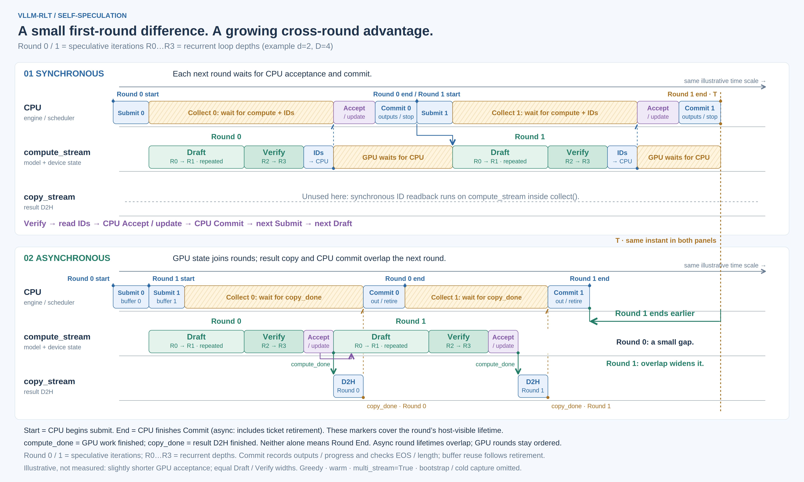
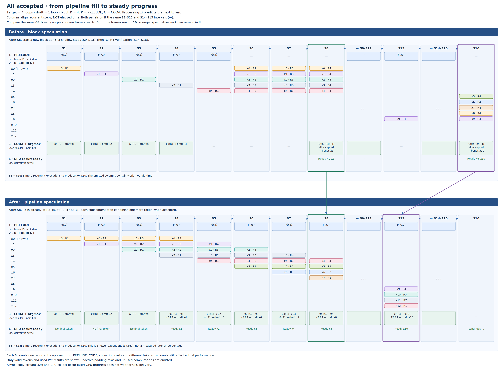
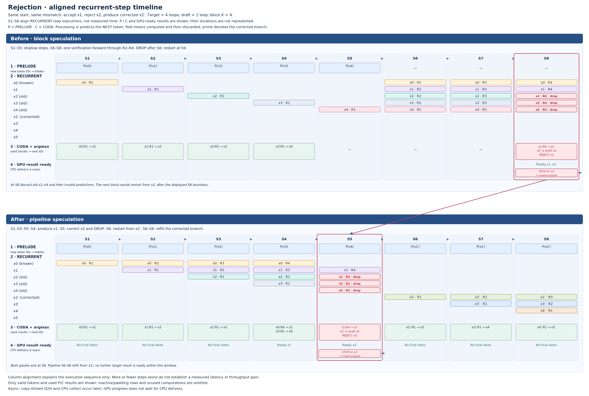

# Self-speculation

This guide covers cross-round asynchronous block speculation and
[pipelined self-speculation](#pipelined-self-speculation).

The cross-round asynchronous block path uses fixed-depth Ouro, `last_exited` KV, greedy sampling,
CUDA execution, and refill scheduling. Triton and compatible paged FlashAttention
backends can consume its GPU-owned context lengths; `auto` selects against this
capability as well as hardware, dtype and block size. Draft depth is configurable, with `d=2, D=4`
as the initial validation configuration. The target depth must match the model.

## Timeline: synchronous versus asynchronous speculation

Cross-round asynchronous speculation keeps the next token and position on the
GPU, so the next round can compute while the previous round's results return to
the CPU. The comparison below shows the dependency change within one stage.



[Open full-size PNG](diagrams/async-speculative-timeline.png) ·
[Open editable SVG](diagrams/async-speculative-timeline.svg) ·
[Interactive diagram viewer](diagrams/index.html#async-speculative-timeline)

The panels follow **the same request through two speculative rounds**, using the
same illustrative time scale and equal draft/verify widths. **Round 0 / Round 1**
identify speculative iterations; **R0–R3 identify zero-based recurrent depths**.
The example uses draft depth 2 and target depth 4. Draft repeats the shallow
R0 → R1 path for its inputs; verification extends their retained hidden states
through R2 → R3. Prelude and coda are included in the draft/verify blocks.
Durations are explanatory, not benchmark results or a predicted speedup.

**Round boundaries.** `Round N start` marks the beginning of CPU submission;
`Round N end` marks completion of CPU Commit, including ticket retirement on the
asynchronous path. These are host-visible lifecycle boundaries, not GPU execution
boundaries. Shared markers explicitly name both events, such as synchronous
`Round 0 end / Round 1 start`. Asynchronous Round 1 starts before Round 0 ends.
`compute_done` marks device completion and `copy_done` marks result-transfer
completion; neither alone is the end of the round. The compact legend below the
timelines defines these terms without adding another comparison panel.

**Match the purple blocks.** Accept/update determines the accepted prefix and
next input token/position. In the synchronous path, this spans CPU greedy
acceptance inside `collect()` and the scheduler's subsequent request progress
update. In the asynchronous path, acceptance and the next token/position
are computed on the GPU. CPU output delivery and EOS/length handling remain on
the CPU, represented separately by the blue **Commit** block.

**What Commit does.** After readback, the CPU interprets the already-decided
result, records accepted output tokens in the Request, reconciles request progress
and reservations, and checks EOS/length limits. In the asynchronous path, the
engine then retires the round ticket so its buffer can be reused. This block
groups collection's host processing and the engine/scheduler update; it is a
diagram label, not a new runtime API. It does not redo GPU acceptance. The
synchronous path performs the corresponding CPU output/progress update too,
although its KV bookkeeping and submission lifetime differ.

**Read the comparison from matching blocks.** Green Draft/Verify blocks represent
the same model work. Purple Accept blocks move from CPU to GPU; blue Commit blocks
remain on the CPU. In sync, Round 1 GPU computation starts only after Round 0's
readback, acceptance, commit and next submission. In async, Round 1 GPU computation
starts once GPU acceptance has updated
its input state, while Round 0's D2H and CPU commit proceed alongside it.

The gold **T** guide marks the end of synchronous **Round 1 CPU commit** and
continues at the same horizontal coordinate into the asynchronous panel. The
horizontal arrow connects asynchronous Round 1's earlier commit to T, comparing
completion of the same two rounds. This is CPU result commitment, not the
earlier GPU-completion event.

The example draws GPU acceptance/update slightly shorter than CPU acceptance,
so the first round's result delivery is only slightly earlier. Subsequent rounds
also overlap prior readback and CPU work, making the completion gap accumulate.
Shorter GPU acceptance is an illustrative assumption, not a measured property or
a guarantee: batch size, launch overhead and implementation determine the actual
cost. Draft/verify durations are equal across panels. The figure explains the
removed host dependency without predicting a speedup or first-result latency.

Both panels use the same three lanes:

| Lane | Synchronous | Asynchronous |
| --- | --- | --- |
| CPU | Submit, wait for computation and IDs, accept, apply request progress, then submit the next round | Submit ahead, collect results in order, apply outputs and retire tickets |
| `compute_stream` | Draft, verify, then produce/read back IDs inside `collect()`; wait for CPU progress before the next draft | Draft, verify, accept and update device state; the next draft consumes that state in stream order |
| `copy_stream` | Unused for this result readback | Wait for `compute_done`, copy compact results into pinned host memory, record `copy_done` |

**Synchronous dependency.** Verification must finish before `collect()` produces
and reads the target/candidate IDs. CPU acceptance then determines the accepted
prefix and correction/bonus token. The scheduler commits progress and truncates
the rejected KV suffix before the next round can be submitted. The orange gap on
`compute_stream` is this CPU-dependent interval. The ID readback is drawn on
`compute_stream`, matching the stream context around `_collect_round()`; it is
not an independent asynchronous copy-stream operation.

**Asynchronous dependency.** Round 1 can be submitted before Round 0 is collected.
Its GPU computation still follows Round 0's acceptance and token/position update.
Meanwhile, `copy_stream` returns Round 0's result. The dashed completion guides
align each CPU wait endpoint with the end of its corresponding D2H transfer.
This removes CPU delivery from the immediate inter-round dependency; it does not
allow dependent GPU rounds to run in parallel.

The first two submissions use the runner's two round buffers. A buffer contains
host/device page tables and result storage; it is separate from persistent
per-request token, position and KV state. It becomes reusable only after output
application and ticket retirement. The illustration stops after Round 1; further
scheduling and buffer reuse are omitted. In sustained execution, the engine collects the
oldest ticket before scheduling beyond its two-ticket limit. CPU stop checks,
resource availability and reservation limits still constrain submission.

**Why there is no `boundary_stream` lane.** In this steady-state speculative
path, prelude, recurrent and coda all execute in the speculative runner's
`compute_stream`, which is supplied by `ModelRunner.core_stream`. Ordinary
prefill/bootstrap execution is outside this comparison. A separate
`boundary_stream` would misrepresent the speculative path shown here.

The diagram assumes greedy, warm execution with `multi_stream=True` and enough
KV/output capacity. Input preparation/H2D are folded into the activities; cold
capture and bootstrap are omitted. With `multi_stream=False`, result copies share
the compute stream and the depicted D2H/compute overlap disappears. Cancellation
or EOS can discard an already-submitted later round, but its resources remain
live until device use completes.

| Diagram operation | Current implementation |
| --- | --- |
| Sync submission, collection and scheduler update | `StageEngine._step()` in [stage_engine.py](../vllm_rlt/engine/stage_engine.py) |
| Sync ID readback and CPU acceptance | `SpeculativeSubmission.collect()` / `SpeculativeRunner._collect_round()` in [speculative.py](../vllm_rlt/worker/speculative.py) |
| Async submission ahead and ordered collection | `StageEngine._step_async_speculative()` / `_collect_speculative()` in [stage_engine.py](../vllm_rlt/engine/stage_engine.py) |
| GPU acceptance and token/position update | `AsyncSpeculativeRunner._accept_and_update_state()` in [async_speculative.py](../vllm_rlt/worker/async_speculative.py) |
| Stream events, result copy and buffer retirement | `AsyncSpeculativeRunner.submit()` and `SpeculativeRoundTicket.collect()` / `retire()` in [async_speculative.py](../vllm_rlt/worker/async_speculative.py) |
| CPU output/progress application | `Scheduler.update_from_output()` in [scheduler.py](../vllm_rlt/core/scheduler.py) |

## Configuration

`LLM` starts a spawned worker process. In Python scripts, create it inside
`main()` and use the `if __name__ == "__main__":` guard shown below. The context
manager closes the worker when inference finishes or raises.

```python
from vllm_rlt import LLM, ExecutionConfig, SamplingParams, SpeculativeConfig


def main():
    with LLM(
        "artifacts/models/Ouro-1.4B",
        device="cuda",
        attention_backend="flash_attn_4",  # Or triton / another compatible paged backend.
        execution_config=ExecutionConfig(async_scheduling=True, cuda_graphs=True),
        speculative_config=SpeculativeConfig(num_speculative_tokens=4),
    ) as llm:
        outputs = llm.generate(
            ["Explain speculative decoding."],
            SamplingParams(temperature=0, max_loops=4, exit_threshold=1.0, max_tokens=64),
        )


if __name__ == "__main__":
    main()
```

The CLI combines `--async-scheduling --attention-backend flash_attn_4 --cuda-graphs
--speculative-tokens 4 --draft-loops 2 --target-loops 4 --temperature 0`.
Random sampling, adaptive exit and preemption remain rejected.
PD can enable speculation on its decode stage. Incoming prompts wait for transfer
completion and shared scheduler admission before CODA bootstraps local speculative
rounds. Cancellation retains GPU resources until the final round completes.
The speculative runner owns its compute and result-copy streams. Setting
`multi_stream=False` orders the copy on the compute stream as well; cross-round
CPU/GPU submission remains asynchronous, but D2H no longer overlaps computation.

## CUDA Graph scope and ownership

`cuda_graphs=True` captures the draft and verification recurrent cores and coda
projection. Prelude, draft/verify control, acceptance, state advancement and
result copies remain eager; this is not a graph of an entire speculative round.
The current verification path uses independent query rows for all backends,
including FA4, rather than packed verification queries.

Each graph entry has stable hidden/metadata storage. Actual positions, write
addresses, context lengths and page tables are copied device-to-device before
replay, without reading token positions or acceptance results on the CPU. Graph
results are cloned before another replay can overwrite the shared output. Stream
events order reuse; the round ticket still retains its own results and KV leases.
Unlike ordinary graphs, these calls do not validate or advance the CPU written
frontier, which intentionally lags in-flight speculative device progress.

Graph keys use the actual query-row count. `cuda_graph_max_batch_size` therefore
needs to cover verification rows (up to requests times `K+1`), not just request
count. Shapes outside this limit or `cuda_graph_max_graphs` execute eagerly.
First-use capture synchronizes and includes warmup; warm the actual shapes before
timing steady-state execution. Recurrent and coda graph managers expose
`captures`, `replays` and `fallbacks` separately.

FA2/FA3 retain their hardware and page-size restrictions. Backend capability
selection is not hardware qualification: the new GPU regressions cover Triton
and FA4 on their test hardware; other generations need their own device runs.

## Execution and ownership

Speculative work enters through `Executor.submit()` like ordinary batches.
The executor dispatches a speculative selection to its local round controller;
the controller uses the same `ModelRuntime` for PRELUDE, RECURRENT and CODA.
It retains its own draft/verify ordering, candidate state and acceptance logic.
There is no cross-stage handoff for each speculative step.

Prompt bootstrap uses the ordinary runner. Refill scheduling returns to the
scheduler after each prompt chunk, where ready speculative work can be selected.
PD can import the completed prompt into the decode stage. These combinations do
not enable mixed scheduling of prompt rows with speculative verification rows.


The synchronous runner reads the acceptance result before constructing the next
round. Cross-round submission needs a different ownership contract: the GPU must
advance the next token and actual KV position while the CPU reserves a safe upper
bound. `MetadataBuilder.prepare_device()` creates and validates a borrowed
`DeviceKVMetadata` containing allocation identities and device access tensors,
without retaining the manager. The runner owns those tensors and completion
events, and retains allocations until the final GPU reader completes. The batch
does not treat uncommitted positions as populated CPU KV. The scheduler tracks outstanding
output reservations separately from committed tokens.

A simpler alternative is to copy each result asynchronously but wait before
submitting the next round for that request. That can overlap independent requests,
but retains a CPU dependency between consecutive rounds. The two-buffer design
removes that dependency at the cost of device state, reservation slack and up to
one discarded round after EOS. The existing synchronous speculative path remains
available by disabling `async_scheduling`; ordinary decoding remains the default
when no `SpeculativeConfig` is supplied.

Prefill and the first sampled token use the native bootstrap path. Thereafter,
the GPU retains each request's next input token and actual position. A round
drafts candidates, retains shallow hidden states, verifies the deep loops in a
batch, and selects the accepted prefix plus correction/bonus on device. Each
query row has its own context length; no packed FlashAttention path is used.

Two reusable `SpeculativeRoundBuffer` slots allow the CPU to submit the next round before delivering the
previous result. All request computation runs in stream order. CPU positions
include outstanding output reservations and are upper bounds used only for
capacity allocation; GPU positions determine RoPE, KV writes and attention.
Requests near output/context limits may wait for a result to recover rejected
reservation capacity. An effective K of zero is a full-depth single-token step.

For a round beginning at position `s` with `a` accepted candidates, the valid
KV frontier and next input position are `s+a+1`. Invalid suffix bytes may remain
in allocated pages, but attention lengths exclude them. The CPU never truncates
GPU state when collecting an older round. CPU `written` bookkeeping continues
to describe native prefill, not in-flight speculative decode; device descriptors
use the reserved allocation and stream-ordered writes instead. Only completed
full prompt pages are eligible for prefix caching.

Every ticket owns its result buffer and page-table snapshot until compute and
copy events complete. EOS/length stopping is applied in output order on the CPU;
one already-submitted later round can finish but its outputs are discarded.
Cancellation removes scheduling eligibility immediately. KV allocations and
device state survive until their final GPU user completes. Request object
identity isolates stale tickets when a request ID is reused.

## Pipelined self-speculation

This experimental mode advances token positions at different loop depths in the
same recurrent batch. Synchronous execution collects each step before advancing;
asynchronous execution keeps token IDs, loop depths, hidden states and acceptance
decisions on the GPU, allowing two steps of the same request to be submitted
before CPU delivery.

`--speculative-mode pipeline` with
`--speculative-tokens 4 --draft-loops 1 --target-loops 4` selects the existing
speculative runner's token pipeline. Each submission advances its live tokens
by `draft_loops`; different requests and depths share the recurrent call.
The runner retains hidden states between submissions, while Scheduler owns
admission, committed outputs, EOS and KV allocation. Rejection discards dependent
tokens; the returned KV frontier preserves surviving speculative work.
The pipeline requires greedy sampling and `last_exited` KV. It supports
`--async-scheduling`, `--cuda-graphs` and `--enable-preemption`, including their
combination with compatible attention backends such as Triton and FA4.
The asynchronous pipeline uses the same compute/copy streams and two leased result
buffers as asynchronous block speculation. The compute stream advances or rejects
token slots; the copy stream transfers compact results to pinned host storage.
Collecting an older step never rewinds GPU state. Inactive slots have masked KV
writes and zero attention lengths. Fixed-shape prelude/coda calls can include
unused rows; this avoids a host dependency for selecting dynamic batch sizes.
Pending steps cannot be preempted. Waiting admissions drain outstanding steps so
Scheduler can select a victim at a completed step boundary. At that boundary,
preemption saves hidden states, loop depths and candidates with the existing KV
snapshot, either resident or CPU-offloaded; both execution modes use the same
`PipelineState` snapshot format. Resumption restores that exact state.
The block mode remains the default.
Low-precision arithmetic can vary with batch composition, so block and pipeline
outputs are not guaranteed to match token for token; evaluate task quality when
comparing the two modes.

`--speculative-tokens` bounds the reserved lookahead window in pipeline mode;
a smaller scheduler token budget may discard descendants and reduce overlap.

### Accepted tokens



The figures use four target loops, one draft loop and block K=4. Each colored
cell identifies an input token and its recurrent depth; `P` is PRELUDE and `C`
is CODA. Processing `xi` predicts `x(i+1)`. Columns count recurrent executions,
not measured time; block verification runs R2–R4 within one forward.
Only valid tokens and used PRELUDE/CODA results are shown; inactive/padding rows
and unused computations are omitted. Output labels mark GPU-ready target results.
In asynchronous execution, copy-stream D2H and CPU collection occur later;
GPU progress, including rejection recovery, does not wait for CPU delivery.

In the accepted path, both green-framed S8 columns have produced `x1`–`x5`.
Block produces them together; pipeline produces one per step from S4 onward.
After S8, pipeline retains `x5:R3`, `x6:R2` and `x7:R1`, so the next five
outputs require five more recurrent executions instead of block's eight.
The purple frames mark GPU-ready results through `x10`: pipeline S13 versus block S16.
Ellipses omit the same intervals in both panels. This is a reduction in
execution count under continuous acceptance, not an equivalent latency claim.
[Open the accepted-path SVG](diagrams/pipeline-token-batches.svg).

### Rejection and recovery



The red frames connect the same rejection: block S8 and pipeline S5 replace
`x2` with `x2′`, produce the correction, and discard dependent work. Block has
already computed old `x2`–`x4` through R4; pipeline discards them at R3, R2 and
R1 respectively. Both preserve the valid causal KV prefix through input `x1`.
Pipeline S6–S8 show refilling from `P(x2′)`; neither further final-token output
nor block recovery is shown before this figure ends at S8.
[Open the rejection SVG](diagrams/pipeline-token-rejection.svg).

### Evaluated and reverted: PRELUDE/CODA row selection

An October 2026 experiment reduced boundary work without changing the recurrent
pipeline. On the GPU, it selected the active depth-zero slot for PRELUDE and the
root/newborn slots for CODA. Each request reserved one PRELUDE row and at most two
CODA rows, retaining placeholders when an endpoint was absent. Native embedding,
Linear and existing CODA graphs were reused; no device decision was read on the
CPU and no custom GEMM was introduced. Gathered results were written back with
`index_copy_`; a `where` preserved retained hidden state when no newborn existed.
Two ordered CODA writes handled coincident root/newborn indices during fill.
Windows of at most two rows kept the original CODA call because selection would
not reduce its batch size.

The comparison used Ouro-1.4B BF16 on one NVIDIA B300 per case, FA4, asynchronous
scheduling and CUDA Graphs, draft/target depths 1/4, K=4, token budget 256 and
prefill chunk size 1024. Fixed prompts produced 128 tokens with greedy sampling
and EOS ignored. Two pipeline engines shared one model; after full-workload
warmup, three interleaved repetitions were timed without a profiler. Timings
include local scheduling and prefill, excluding HTTP/network overhead.

| Input / concurrency | Original tok/s | Selected tok/s | Change | E2E p50, original → selected |
| --- | ---: | ---: | ---: | ---: |
| 128 / 8 | 790.27 | 785.78 | −0.57% | 0.988 → 1.000 s |
| 4096 / 32 | 172.22 | 168.10 | −2.39% | 23.680 → 24.263 s |

A separate interleaved short-input ablation measured 886.09 tok/s for its
contemporaneous baseline, 881.12 for PRELUDE only (−0.56%), 881.24 for CODA only
(−0.55%), and 882.04 for both (−0.46%). Both phases shifted in absolute speed;
only within-phase comparisons are valid. All timed outputs matched the original
pipeline, with zero graph captures/fallbacks during timing. A separate 256-question
GSM8K evaluation at each draft depth 1/2 also matched all 512 original outputs.

Paired ops-only/full profiles covered eight steps and 64 output tokens. Selecting
CODA rows reduced its projection shape from 32 to 16 rows, but projection-kernel
time barely changed (0.297 → 0.293 ms). Ordinary kernel launches increased from
4,552 to 4,672, including 24 new `index_copy_` calls and eight additional argmax
operations. Aggregate GPU kernel time was 45.08 → 44.95 ms; this is not E2E time.
The saved work did not offset selection and result-copy overhead. The experiment
was reverted; the runtime retains the simpler fixed-slot boundary calls. These
results do not rule out a different implementation or workload benefiting.

## Validation

The following commands and historical evidence concern the cross-round block
path; they do not establish validation of the pipeline mode.

Inside a Slurm GPU allocation, use the repository environment:

```bash
.venv/bin/python -m pytest tests/test_async_speculative.py --run-gpu -q
.venv/bin/python -m pytest tests/test_async_speculative_graphs.py --run-gpu -q
.venv/bin/python -m pytest tests/test_serving.py --run-gpu -k speculative -q
```

The tests exercise eager/graph output agreement, graph-limit fallback, page growth,
FA4 execution, PD handoff, two GPU rounds before CPU delivery, rejection positions,
K/length boundaries, mixed requests, prefix reuse, EOS, cancellation, ID reuse
and partially submitted failures. CPU-only test results do not qualify the GPU
path. Compare BF16 runs on the same hardware and Triton backend: synchronous
speculation versus asynchronous speculation, and fixed-depth native async versus
async speculation. Record committed tokens, variability, memory and traces;
do not infer a speedup from successful asynchronous submission alone.

The page-table snapshot uses flat reusable pinned/device storage. Each round
views only `batch_size * max_loops * active_page_width` entries as a contiguous
three-dimensional table, clears that region and copies it once. Inactive storage
is untouched; ragged rows are padded within the active width. This reduces the
number of entries prepared and submitted for H2D. The
[recorded measurements](runtime-history.md#active-region-preparation-and-transfer)
separate that reduction from end-to-end effects.

## Historical evidence

The [validation history](runtime-history.md#recorded-gpu-validation-2026-10-10)
retains the dated correctness runs, BF16 measurements, profiling observations
and qualification limits. These results describe their recorded revisions;
they do not qualify the current checkout or establish production serving capacity.
