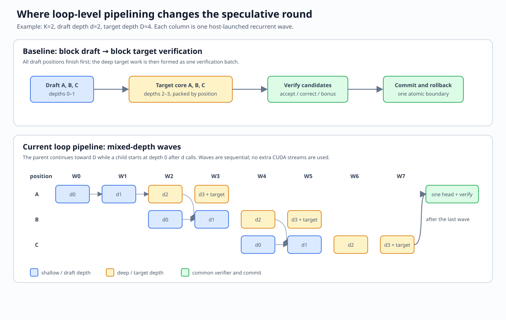

# Loop-level speculative execution

This opt-in synchronous path implements the mixed-depth batching portion proposed
in [Issue #43](https://github.com/ThinkFlowLab/vllm-rlt/issues/43): advance shallow work
for later token positions in the same recurrent call as deep work for earlier
positions. It retains the existing finite speculative window and atomic round
commit. The default remains the original block verifier.

## Enable

```python
SpeculativeConfig(
    num_speculative_tokens=4,
    draft_loops=2,
    target_loops=4,
    loop_level_pipelining=True,
)
```

The offline and serving CLI accept `--speculative-tokens 4 --loop-level-pipelining`.
Greedy-only early suffix pruning can be enabled separately with
`--early-rejection-pruning`; it is off by default. Top-p and top-k sampling are
supported by the same loop pipeline, but sampling still verifies the complete
finite window before applying rejection sampling. Early pruning is intentionally
greedy-only because greedy acceptance is a deterministic candidate/argmax
comparison, while sampling acceptance requires the target and proposal
distributions, random draws and ordered correction sampling.
Existing restrictions apply: `last_exited`, full fixed target depth, synchronous
refill scheduling, and no preemption or PD.

The implementation has three execution choices:

| Mode | Recurrent schedule | Verification | Intended use |
| --- | --- | --- | --- |
| Baseline | Complete all draft positions, then complete target depth | One batched verifier window | Reference path and default |
| Loop | Advance active positions one depth per mixed-depth wave | Reorder completed target rows into the common verifier | Measure mixed-depth batching |
| Loop + greedy prune | Loop schedule with target-ready rejection checks | Stop future suffix branches after the first mismatch | Optional greedy experiment |

The loop mode is a synchronous pipeline. It does not add CUDA streams, reduce the
number of recurrent rows, or retain hidden state across speculative rounds. Its
possible benefit comes from the shape and timing of mixed-depth batches; metadata,
Python scheduling, Coda fragmentation and dynamic CUDA Graph shapes are additional
costs.

## Execution and state

### Loop-level flow

The loop path keeps one branch for each active token position. A branch carries
its request index, token offset, recurrent hidden state and current loop depth.
Each wave advances every active branch by one depth. When a branch reaches the
draft depth, its coda output starts a child branch while the parent continues
toward the target depth. When a branch reaches the target depth, its target
logits are saved for the existing verifier.



The upper lane shows the baseline's block draft followed by block target
verification. The lower lane shows the loop pipeline: after A reaches the draft
depth, B starts at depth 0 while A continues at a deeper level; C starts two
waves later. The target rows are reordered into the common verifier only after
their corresponding branches reach the target depth. This is the loop-level
pipeline added in this PR; the waves are still launched sequentially on the
current host path.

This PR currently implements only the synchronous finite-window path. Mixed-
depth waves are launched sequentially from the host; there are no CUDA streams,
asynchronous scheduler overlap, cross-round hidden-state retention, preemption,
or PD execution. The existing `SpeculativeResult` and atomic KV commit/rollback
boundary are intentionally preserved.

For K=2, d=2 and D=4, A is the last committed input, B and C are proposals.
Numbers below are zero-based depths; columns are successive recurrent calls.

| Input position | 1 | 2 | 3 | 4 | 5 | 6 | 7 | 8 |
| --- | --- | --- | --- | --- | --- | --- | --- | --- |
| A | 0 | 1 | 2 | 3 | | | | |
| B | | | 0 | 1 | 2 | 3 | | |
| C | | | | | 0 | 1 | 2 | 3 |

After A completes depth 1, its shallow head proposes B. Call 3 batches A at
depth 2 and B at depth 0. After B completes depth 1, it proposes C while A's
full-depth head produces the distribution that verifies B. These head rows are
batched too. C's full-depth distribution supplies the bonus token.

Each branch stores its item index, position offset, hidden state and completed
loop count. A child starts d calls behind its parent. Therefore, at every layer,
the same-depth KV for earlier positions is already available before the child's
attention. `_prepare_batch` supplies a separate depth plane and causal context
length for every row. The pipeline uses single-query paged attention, not packed
multi-query prefill. No shallow KV is copied into uncomputed deep planes.

Each position/depth is computed exactly once. Proposals remain on the device and
greedy target IDs are read back once per mixed-depth wave. For sampling, the
filtered proposal distribution `q` is retained for each draft and the common
verifier applies rejection sampling with the request's generator from the shared
`RngRegistry`. Different GEMM shapes and the changed draft/verify interleaving can
change BF16 results or the fixed-seed token sequence; same-seed agreement is not a
general sampling correctness guarantee.

Completed target logits are reordered into item/position order for the common
verifier. `SpeculativeResult` and engine commit stay unchanged: keep KV through
the initial input and accepted candidates; invalidate every depth's rejected
suffix; leave correction/bonus unforwarded. Engine EOS/length handling and
exception cleanup remain responsible for the request lifecycle.

## Scope and benefit

The default finite-window path does **not** implement cross-round hidden-state
retention or the complete continuous LoopSpec algorithm. The optional greedy
pruning path checks a target row when its coda output is ready and skips later
suffix branches after rejection. Work that already entered the mixed-depth wave
cannot be cancelled. Sampling still runs the complete window before
verification. Greedy target and draft IDs are read back once per mixed-depth
wave; the host-side rejection decision remains the pruning synchronization
boundary. No new CUDA streams or asynchronous scheduler are introduced.

### Why pruning is greedy-only

For greedy decoding, a target row produces one deterministic token ID. Once that
ID is available, the runner can compare it with the candidate and stop creating
later branches for that request after the first mismatch. The already submitted
rows still finish, but suffix rows that have not entered a wave are avoided.

Top-p and top-k use rejection sampling. Acceptance depends on the filtered target
distribution `p`, the filtered draft distribution `q`, and a random uniform draw;
on rejection, the correction token is drawn from `normalize(max(p - q, 0))`.
A target argmax mismatch is therefore not equivalent to rejection: a candidate
can differ from the target argmax and still be accepted, while a candidate that
matches the argmax can still be rejected by the random draw. Applying the full
decision as soon as each target row is ready would also require retaining every
proposal distribution, preserving the request's RNG order, sampling a residual
correction token, and invalidating all descendants generated from the rejected
candidate. The current sampling path instead computes the finite window and
applies the existing verifier in order, preserving its distribution and RNG
behavior. Device-side batched acceptance can support sampling pruning in a later
change.

For a uniform window, both the original block verifier and this pipeline require
`d*K + D` recurrent calls and `(K+1)*D` recurrent rows. Pipelining changes batch
shapes and head batching, not total recurrent work or that critical path. Its
cost also includes extra per-step metadata preparation and loss of the original
verifier's packed FA4 attention. Speedup must be measured; mixing depths alone
does not guarantee an improvement. Reducing round bubbles or wasted suffix work
would require a follow-up design for acceptance and state lifetime.

## Parameters and results

The reference measurements use an Ouro-1.4B checkpoint on an NVIDIA A100-SXM4-40GB,
BF16, Triton attention, CUDA Graphs, `K=4`, `draft_loops=2`, `target_loops=4`,
32 generated tokens and five timed repetitions per point. The benchmark compares
the original block verifier with the loop pipeline using the same prompts and
prefill barrier. Throughput is committed decode tokens per second.

For C=1 through C=64, the CUDA Graph limit is 128. The C=128 rows use limit 256
because the loop's largest mixed-depth wave is approximately `2C` rows. The C=64
wave is at most 128 rows and therefore remains within the default limit.

### Greedy

| Concurrency | Baseline | Loop | Change | Loop + greedy prune | Change |
| ---: | ---: | ---: | ---: | ---: | ---: |
| 1 | 58.6 | 56.9 | -2.8% | 66.7 | +13.8% |
| 4 | 217.2 | 214.7 | -1.1% | 215.5 | -0.7% |
| 8 | 420.4 | 409.9 | -2.5% | 412.4 | -1.9% |
| 16 | 790.8 | 780.1 | -1.4% | 782.3 | -1.0% |
| 32 | 1321.2 | 1474.1 | +11.6% | 1468.6 | +11.1% |
| 64 | 2434.1 | 2649.6 | +8.9% | 2625.5 | +7.7% |
| 128 | 4092.9 | 4231.2 | +3.4% | 4207.7 | +2.8% |

### Sampling

Sampling uses `temperature=0.8`, `top_p=0.8`, with `top_k=-1` for top-p and
`top_k=7` for top-p + top-k. Early pruning is disabled. The C=128 rows use
CUDA Graph max 256; all other rows use max 128.

| Concurrency | Top-p baseline | Top-p loop | Change | Top-p + top-k baseline | Top-p + top-k loop | Change |
| ---: | ---: | ---: | ---: | ---: | ---: | ---: |
| 1 | 61.8 | 58.4 | -5.5% | 51.6 | 46.8 | -9.4% |
| 4 | 205.2 | 159.9 | -22.0% | 140.3 | 138.0 | -1.6% |
| 8 | 295.1 | 330.2 | +11.9% | 236.8 | 254.9 | +7.7% |
| 16 | 524.3 | 493.9 | -5.8% | 417.3 | 393.2 | -5.8% |
| 32 | 669.1 | 728.7 | +8.9% | 520.3 | 533.6 | +2.6% |
| 64 | 870.7 | 908.3 | +4.3% | 628.2 | 649.4 | +3.4% |
| 128 | 1057.5 | 953.4 | -9.8% | 730.6 | 805.7 | +10.3% |

The results are workload-dependent. Loop-level scheduling does not reduce the
number of recurrent rows; its potential benefit comes from mixed-depth batch
shapes and device utilization. Metadata preparation, Python scheduling, Coda
fragmentation and graph capture shape can outweigh that benefit. Sampling may
also diverge from baseline at a fixed seed because draft sampling and rejection
sampling are interleaved differently; this does not by itself indicate an
incorrect sampling distribution.

In summary, the synchronous loop path is a clear win only at selected higher
concurrency points: greedy throughput improves by 3-12% from C=32 in this
benchmark, while low-concurrency runs regress by about 1-3%. Greedy pruning is
strongest for a single request with an early mismatch (+13.8% at C=1), but adds
little at larger batches because work already submitted in the current wave
cannot be cancelled. Sampling remains workload-sensitive, ranging from a 22%
regression to a 12% improvement for top-p and from a 9% regression to a 10%
improvement for top-p plus top-k. These results show that mixed-depth scheduling
alone does not guarantee a speedup; asynchronous overlap, state retention,
device-side acceptance and more efficient dynamic compaction remain follow-up
work.

At low concurrency, metadata preparation, Python scheduling and fragmented Coda
work outweigh the mixed-depth benefit. The measured greedy loop becomes faster
from C=32 onward, reaching its best gain at C=32; at C=128 it remains faster only
after raising the Graph limit so the `2C` wave can be captured. Greedy pruning is
helpful for a single request with early rejection, but adds little at larger
concurrency because much of the suffix work has already entered a wave. Sampling
is more workload-sensitive: top-p is slower at C=128, while top-p + top-k is
faster there, showing that the loop benefit is not a general consequence of
sampling or concurrency alone.

## Validation

```bash
OMP_NUM_THREADS=1 python -m pytest -q
python -m ruff check .
python -m ruff format --check vllm_rlt tests benchmarks

# On an allocated CUDA device with Triton:
python -m pytest -q tests/test_speculative.py --run-gpu -m gpu -k 'not flash_attn_4'
```

Tests exercise mixed depths including non-divisible d/D, actual hidden/logit/KV
agreement against a serial reference, every rejection boundary and bonus,
greedy/sampling batches, K=1/2/4/8, shortened windows, EOS, prefix reuse,
incremental allocation, cancellation and partial execution failure. CUDA coverage
checks eager/graph parity and one greedy readback per round.

For a bounded real-checkpoint feasibility run:

```bash
python -m benchmarks.loop_speculative \
  --model /path/to/local/Ouro-1.4B \
  --cuda-graphs --k 4 --concurrency 1 --new-tokens 32 --repeats 5 \
  --output /tmp/loop-speculative.json

# Sampling variant (top-p + top-k):
python -m benchmarks.loop_speculative \
  --model /path/to/local/Ouro-1.4B \
  --cuda-graphs --k 4 --concurrency 8 --new-tokens 32 --repeats 5 \
  --temperature 0.8 --top-p 0.8 --top-k 7 \
  --output /tmp/loop-speculative-top-p-top-k.json
```

The harness warms both engines, completes a common prefill barrier before timing,
ignores EOS to commit equal work, synchronizes timing boundaries, alternates trial
order, and saves raw timings, outputs, first divergences and runtime metadata.
For large loop batches, `--cuda-graph-max-batch-size 256` allows Graph capture of
the 2C mixed-depth wave when C=128; the default is 128.
`--prompts` accepts a JSON list of strings; `--backend flash_attn_4` requires
compatible hardware. Peak memory includes both resident engines; the recorded
checkpoint config hash is not a weight hash. This small run does not replace
RFC #43's fixed-input real-model diagnostics, sampling distribution checks,
long-context/serving matrix or BF16 acceptance criteria.

Raw benchmark JSON is stored under `artifacts/loop-speculative/`; the extended
run notes include the runtime metadata and per-repetition timings. This work is
an opt-in implementation of the loop-level direction in Issue #43; it does not
claim that mixed-depth scheduling reduces total recurrent work or improves every
hardware and workload combination.
