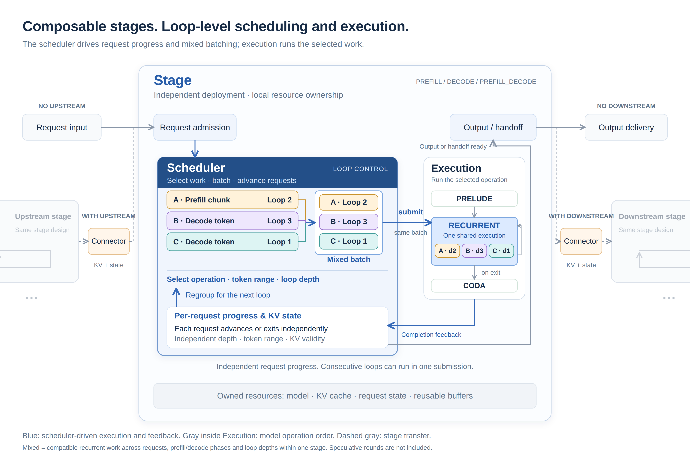

# An inference foundation for loop models

vllm-rlt aims to become both a foundation for executing loop-architecture models
and a collection of engineering knowledge about how to run them well. Its purpose
is to make current models useful while leaving behind implementations, design
reasoning, and evidence that others can build on. A future RSI system or a highly
customized inference engine should be able to draw from this work, whether it
adopts the runtime, reuses a component, or learns from a measured tradeoff.

The starting point is a need for an engine that treats recurrent depth as part
of inference scheduling and state management. Executing a loop model is only
part of that requirement: the engine must also be able to schedule between loops,
combine compatible work, and track KV validity as requests advance through
different depths. In an architecture that keeps these iterations inside an
opaque model forward, exposing them changes assumptions across the scheduler,
execution path, and cache lifecycle. It is a change to the engine's core
contracts, rather than a feature that can be added through a model adapter.
vllm-rlt takes an independent implementation approach so that these contracts can
be designed around loop-level inference from the outset, instead of maintaining
extensive changes across an existing engine's core.

vllm-rlt is an independently implemented inference engine and does not depend on
vLLM. It draws on selected engineering conventions and feature designs from
vLLM, including request scheduling, continuous batching, paged KV management,
chunked prefill, and MRV2-inspired async-first execution and persistent-batch
design. These are references for our own implementation, not a runtime or codebase
that vllm-rlt extends.

These ideas remain valuable for loop models. The additional challenge is that a
token's computation can revisit recurrent layers at successive depths, and
requests can take different paths through those depths. The runtime needs to
represent that progress explicitly so that scheduling and resource management
can make use of it.

## Design philosophy

**Stage is the deployment and resource boundary; loop is the basic unit of
execution and scheduling within a stage.**

Stage ownership remains explicit as prefill, decode, and speculative computation are
arranged across resources; loop-level execution exposes the progress needed for
mixed batching and depth-aware scheduling. We follow an async-first approach:
input preparation and output collection have separate lifetimes, connected by
submission identity and completion events, while persistent device state and
reusable buffers avoid unnecessary reconstruction. A common execution contract
preserves specialized layouts, continuous multi-loop execution, CUDA Graphs, and
stream overlap. Through this independently implemented engine, we aim to build
reusable foundations and practical knowledge for loop models, future RSI
systems, and custom inference engines.

## Why stages and loop-level execution are both needed

PD and speculative inference require flexible placement of computation and clear
resource ownership. Stages let prefill, decode, and speculative computation use
the same local execution machinery across deployment arrangements. Connectors
handle cross-stage state transfer; local draft/verify work can stay within one
stage.

Deployment flexibility alone is insufficient. If recurrent iterations remain
hidden inside a model forward, the scheduler cannot regroup requests between
loops. True loop-level inference exposes each request's operation, token range,
recurrent depth, and KV validity to scheduling and execution. This enables
compatible prefill chunks and decode tokens to share recurrent batches, while
preserving each request's progress and exit decisions. Current mixed batching
uses this capability; it does not include speculative rounds.

Both boundaries are necessary: stage separates resource placement from execution,
while loop-level scheduling makes iterative computation available for batching
and control. Neither requires interrupting every loop. Consecutive loops can run
in one submission, retaining atomic prefill, specialized layouts, CUDA Graphs,
and asynchronous overlap without adding per-loop host synchronization.

## Architecture overview

[Open full-size PNG](diagrams/stage-architecture.png) ·
[Open SVG](diagrams/stage-architecture.svg)

The central stage owns its scheduling, execution, and resources. Optional
upstream and downstream stages connect through connectors; without them, the
stage receives requests and delivers outputs directly.

Inside the scheduler, request A's prefill chunk at loop 2 joins request B's decode
token at loop 3 and request C's decode token at loop 1 in one mixed recurrent
batch. The colors follow each request into shared execution: batching does not
require their phases or loop depths to match. Each request retains its own token
range, depth, and KV state, then advances or exits independently. The scheduler
can regroup the remaining work for the next loop.

PRELUDE and CODA remain separate operations; the illustrated mixing applies to
compatible RECURRENT work, not speculative rounds. Consecutive loops can also
run locally without a host synchronization after every iteration.

The scheduler is the control center: it selects operations, token ranges, and loop
depths, forms compatible batches, and uses per-request progress to decide what
runs next. Execution runs the selected operation. Its arrows show the model's
PRELUDE → RECURRENT → CODA order, including recurrent repetition; they do not
mean every submission runs all three operations.

## Inside one stage

[Open PNG](diagrams/stage-components.png) · [Open SVG](diagrams/stage-components.svg)

Read the outer boundaries first: `StageClient` lives in the caller process;
`StageWorker` runs in a spawned worker process. Inside that worker, `StageEngine`
coordinates local inference, while the optional connector manages transport.
Boxes show component membership, not exclusive ownership of every referenced
tensor. Solid arrows show calls or returns; dashed lines identify shared
references and lifecycle relationships. The `step()` area depicts StageEngine
methods, not an additional controller class.

**Client and worker.** StageClient starts and manages one worker through a
`multiprocessing.Pipe`. It sends requests/control commands, keeps external-ID to
execution-generation mappings and receives outputs/replies. Its `step()` polls
outputs; it does not remotely execute a model loop. StageWorker loads the model,
creates the engine and optional connector, and runs the local service loop:
handle commands, advance transport, call `engine.step()`, send available outputs.
Registering a request and completing its generation are separate events.

**Engine and scheduler.** StageEngine calls Scheduler to select work. Scheduler
owns its local Request registry, phase queues and policy, checks admission/KV
capacity and returns selected operations, token ranges and depths. It does not
invoke ModelRunner. StageEngine submits the returned batch, retains tickets,
handles required results and applies progress, including requeueing and stop or
retirement decisions. The engine drives this cycle even when the caller is not
polling outputs.

**Executor and runners.** Engine calls `Executor.submit(batch)`. Executor binds
ordinary work into an execution batch and dispatches it to ModelRunner, or
routes a speculative selection to the local round controller. StageEngine
constructs these objects; Executor references them rather than creating another
model/KV owner. Runners manage preparation, buffers, stream/event dependencies,
execution and result storage; the ordinary runner also handles sampling after
CODA. A returned ticket does not imply device completion.

**Shared execution and resources.** ModelRunner constructs ModelRuntime and the
speculative controller references that same runtime. Both use the worker-loaded
model, the engine's KV manager and shared RNG registry. The runtime executes the
selected PRELUDE, RECURRENT or CODA operation; the three labels are alternatives,
not a mandatory three-step sequence in each submission. A submission can include
multiple recurrent loops. Packed prefill, persistent decode buffers, graph replay
and optional stream overlap remain execution choices behind this interface.

| Resource / mechanism | Owner or coordination boundary |
| --- | --- |
| Worker process, channel and host-side ID mappings | StageClient; connected workers are coordinated by the deployment host |
| Loaded model and local service loop | StageWorker; the engine and runners reference the same loaded model |
| Request registry, phase queues and selection policy | Scheduler; StageEngine coordinates lifecycle and progress |
| KV pages, mappings, validity and references/pins | KVCacheManager, shared by local scheduling and execution |
| RNG registry and pending results | StageEngine; runners use the shared RNG, and tickets retain their result storage |
| Input buffers, GPU events and readback storage | Runner/controller owners, retained until consumers finish |
| Preemption snapshots | Engine-owned PreemptionManager, invoked through scheduler callbacks |
| Transport staging and remote-access lifetime | Connector; local Request/KV changes are coordinated through StageEngine |

**Connector and deployment.** Worker calls `connector.progress()` independently
of engine progress. Connector readiness/backpressure reaches Scheduler through
the engine's readiness predicate. Import/export and safe release also coordinate
with the engine; KV/hidden transport between peer connectors is distinct from
Client/Worker control messages. The drawing shows those two communication paths
separately. Detailed data movement is in the [stage handoff diagram](scheduler.md#3-request-handoff-between-reusable-stages).

`prefill_decode`, `prefill` and `decode` use this same worker/engine structure.
For PD, the deployment coordinator manages multiple StageClients and connectors;
loop scheduling stays local. Mixed is a batching policy, and speculation is an
optional local round controller, not another deployment role. Current mixed
batches do not include speculative rounds. The launcher currently supports single
stages and same-host PD GPU pools; other compositions require additional deployment
support. See [runtime compatibility](runtime.md#execution-batches-and-mixed-scheduling).

`LLMEngine` is currently a compatibility alias for `StageEngine`, not another
layer. An entrypoint variable named `engine` can hold a StageClient; the diagram
uses concrete component names to avoid confusing that proxy with the local engine.

Code: [StageClient](../vllm_rlt/engine/llm_engine.py),
[StageWorker](../vllm_rlt/engine/worker.py),
[StageEngine](../vllm_rlt/engine/stage_engine.py),
[Scheduler](../vllm_rlt/core/scheduler.py),
[Executor / ModelRuntime](../vllm_rlt/worker/executor.py),
[ModelRunner](../vllm_rlt/worker/model_runner.py), and
[connector contract](../vllm_rlt/engine/connector.py).

## Where the details live

| Question | Guide |
| --- | --- |
| Which loops can share a batch, and when does a request wait? | [Loop-level scheduler](scheduler.md) |
| How are inputs prepared, transferred and executed? | [Runtime execution and configuration](runtime.md) |
| Which KV history does a loop read, and who retains it? | [Model semantics](design.md) and [KV management](kv_cache_walkthrough.md) |
| How do draft/verify rounds advance asynchronously? | [Asynchronous speculation](async-speculative.md) |
| How do I launch and serve a configuration? | [First-run guide](launching.md) and [HTTP serving](serving.md) |
