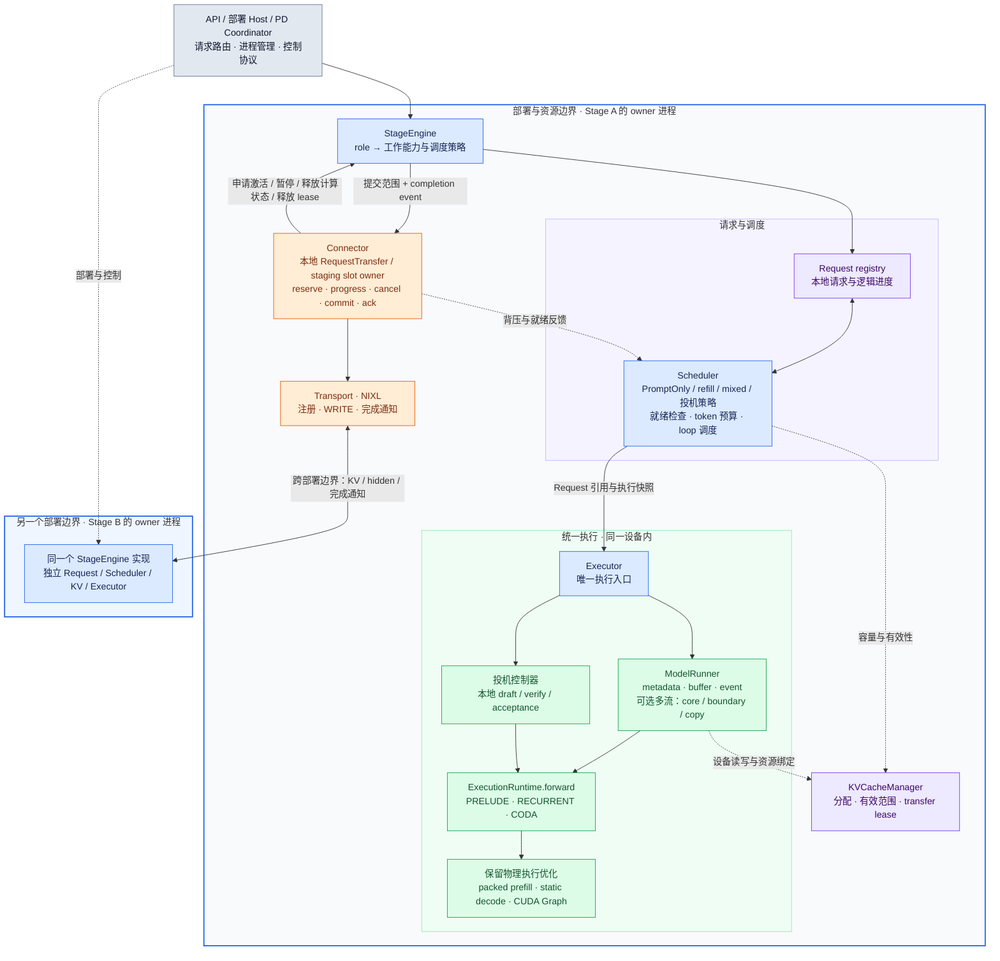
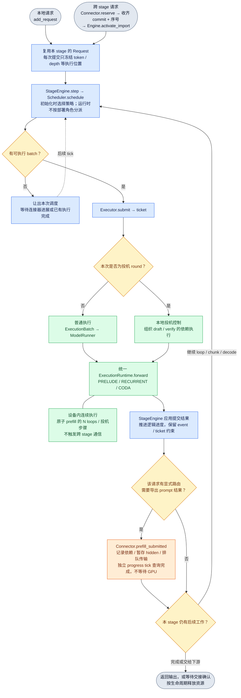
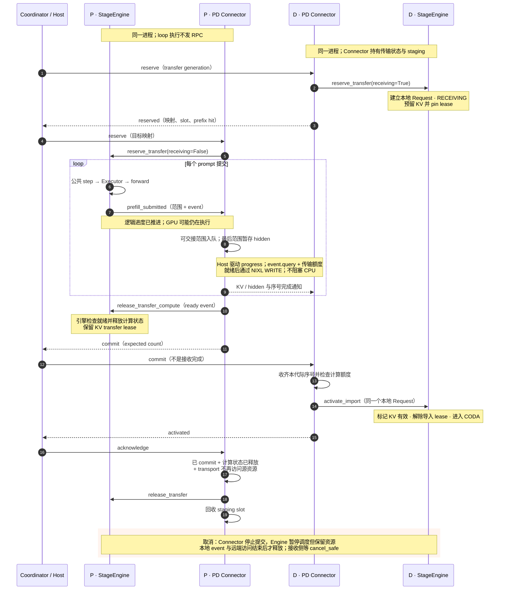

# Stage 部署边界与统一执行

stage 是部署与资源边界；loop 是 stage 内部的执行与调度粒度。

本文描述当前工作区实现。以下使用 Mermaid 绘制正式图形。

**直接看图：[离线图形查看页](diagrams/index.html)**（无需 Mermaid 插件或网络）。
也可查看 [架构图 SVG](diagrams/stage-architecture.svg)、[执行流程 SVG](diagrams/unified-forward.svg)、
[PD 时序 SVG](diagrams/pd-handoff.svg)。每张图同时提供 PNG 与可编辑的 `.mmd` 源码。

Mermaid 是一种用文本描述节点、箭头、分支和时序，再自动排版为图形的格式。
支持 Mermaid 的 Markdown 预览会直接显示下面的图；不支持时请打开上述查看页。

## 1. 框架图：每个部署 stage 都是同一种 StageEngine



`StageConfig.role` 是部署允许承接的工作范围，不是本次 forward 的标签。
`SchedulerConfig.mode` 是 stage 内的调度策略；两者独立。
初始化时将角色转换成 `accepts_prompt` / `produces_tokens` 能力，Scheduler 据此选择
PromptOnlyPolicy 或既有 refill/mixed/投机策略；公共 `_schedule` 只调用
`Scheduler.schedule`。decode 的入口限制由 Scheduler 检查，prompt-only 的显式路由
由 readiness 契约检查。所有 stage 统一 submit；无 host 输出的提交不增加结果回读。
例如 role=mixed 可使用 refill 或 mixed batching，也可配置本地投机策略。
投机不创建新的部署 stage，draft/verify 在本 stage 的控制器与 GPU 上连续执行。

**通信由请求的路由决定。** `connector.exports(request)` 表示该请求的 prompt
结果需要交给下游。mixed stage 可同时保留本地请求并导出另一请求；不会因为
有 connector 就把所有请求都搬走，也不会因为角色为 mixed 就禁止导出。

当前 PD launcher 仍启动 P/D 两类进程，每个进程实例化相同 StageEngine。
单 stage API 在调用方的 owner 进程里实例化 StageEngine；`LLMEngine` 是兼容别名。
本次没有新增任意拓扑 launcher，也没有让一次 loop 调度启动或切换进程。

## 2. 流程图：统一提交与逻辑进度



所有执行只通过 `Executor.submit(batch)` 返回 ticket，没有 `execute` 入口。
`async_scheduling` 控制结果回收时机，不再选择另一套执行接口：
关闭流水调度时，仅对有 host 结果的 ticket 调用 `collect()`；开启时保留 ticket，按依赖回收并推进后续提交。
无 host 结果的 prefill/loop 不为推进逻辑进度强制等待 GPU，设备依赖由 event 约束。
普通投机的 draft/verify 在 `submit()` 中提交，接受判断在 `collect()` 中完成；
异步投机保留设备接受判断和双 round buffer 的流水方式。
普通、mixed、P-only 的 prompt 都通过 `_apply_prefill_progress` 推进；
split prefill 在其中调用 `_apply_split_prefill_progress`。

原子 prefill 的 ExecutionBatch 为 PRELUDE + N loops，hidden 连续留在设备上。
split prefill 的每次 RECURRENT 提交可以交回 scheduler；交回 scheduler 不等于导出数据。
chunk 大小、loop 提交边界、stage 通信边界是三个不同的决定。

## 3. 时序图：PD connector 与资源寿命



commit 仅证明提交结束，不证明接收完成。实际 PD 协议继续使用独立的 transfer ID
作为代际，以及序号集合防止旧消息激活新请求。

取消时先停止新的提交；远端写入与本地 hidden 暂存拷贝都结束后才复用资源。
本次补充了取消路径的 `last_event.query()` 检查，避免模型事件完成但 hidden
暂存拷贝仍在执行时过早复用 slot。发生计算/传输异常时保留 lease，由部署 owner
按原有 PD 协议先终止远端写入方，再处理接收资源。

## 4. 文件职责与走读顺序

| 文件 | 负责的边界 |
| --- | --- |
| `engine/stage_config.py` | 部署身份与 accepts_prompt / produces_tokens 能力，不含 loop 进度 |
| `engine/stage_engine.py` | stage 的资源 owner；请求建立、调度、提交和逻辑结果应用 |
| `engine/llm_engine.py` | 旧 API 名称兼容，不维护第二份执行逻辑 |
| `core/scheduler.py` | 本地 Request registry、队列、预算、ScheduledRequest 快照、就绪检查 |
| `core/scheduling_policy.py` | PromptOnly/refill/mixed/投机选择与公平性；运行时不判断部署 role |
| `worker/executor.py` | 单个 stage 的执行入口；普通 batch 绑定与投机 round 分派 |
| `core/execution.py` | ExecutionBatch/StateSpan：不可变操作、位置、深度绑定 |
| `worker/model_runner.py` | metadata、流、buffer、hidden/KV 读写、event、提交 ticket |
| `worker/execution.py` | PRELUDE/RECURRENT/CODA 的统一模型 forward |
| `worker/speculative.py` / `async_speculative.py` | 本地 draft/verify/接受算法及其设备状态 |
| `engine/connector.py` | StageConnector 的执行通知契约；TransferConnector 的 progress/cancel/commit/ack 生命周期契约 |
| `pd/connector.py` | RequestTransfer、staging slot、预留与交接协议的 owner；按请求的传输方向推进 |
| `pd/transport.py` | NIXL 连接、注册、传输、完成通知 |
| `pd/worker.py` | 初始化进程资源、解码控制消息、驱动 connector.progress 与公共 engine.step、交付输出 |
| `pd/engine.py` | 现有 coordinator：进程/请求路由、reservation、取消与故障顺序 |

建议先看 `StageEngine._schedule`，再看 `Executor.submit`、
`ModelRunner.submit`、`ExecutionRuntime.forward`，最后回到
`StageEngine._update` 与 `_apply_prefill_progress`。

`ScheduledRequest` 不是另一种生命周期 request，它只引用本地 Request 并保存本次
选中的 token 范围、depth 和 phase。`ExecutionBatch` 把这些引用转换为执行操作绑定，
也不重建 Request 或准备 KV metadata；metadata 仍由 ModelRunner 一次准备。
这个快照是必要的：提交后 Request.loops_done 可以推进，但已提交的 KV 地址不能跟着改变。
旧的 `ScheduledWork`、`ExecutionPlan`、`StageWorkers` 及 `worker_stage` 分派已经移除。

`request.Stage` 仍是既有生命周期 phase 名称，例如 PREFILLING_RECURRENT、CODA。
它不表示进程，也不再用于创建部署 worker；部署身份以 StageConfig 为准。

### 交接接口与唯一状态 owner

| 状态 | owner | 跨模块操作与释放证据 |
| --- | --- | --- |
| 本地 Request、执行进度、调度队列 | StageEngine / Scheduler | Connector 调用 `suspend_transfer`，不直接修改队列 |
| 模型 hidden、runner slot 与事件 | StageEngine / ModelRunner | `release_transfer_compute(request, ready_event=...)` 检查对象身份与最终 staging event；未就绪返回 False |
| KV 分配、有效性与 transfer lease | StageEngine / KVCacheManager | 收齐序号后 `activate_import`；远端访问结束后 `release_transfer` |
| RequestTransfer、传输序号、commit/ack、staging slot | PDStageConnector | `reserve` 建立一次；`progress` 非阻塞推进；结束后回收 slot |
| NIXL 注册、传输句柄、完成通知 | NixlConnector | `submit` / `poll` / `busy` 提供设备传输事实 |
| 进程、控制通道与故障终止顺序 | PDWorker / Coordinator | Host 转发控制消息；故障时先终止写入方再回收接收资源 |

`StageConnector` 保持轻量执行通知接口；需要跨进程交接的实现同时满足
`TransferConnector` 生命周期契约。PD 的 prompt 预留参数由 `PDStageConnector.reserve`
定义，不把 NIXL 的目标映射塞进公共 forward 接口。当前导入仍是完整 prompt → CODA，
不是任意中间 loop 迁移。

PDWorker 不维护另一份 transfer registry，不直接操作 Request.hidden_state、调度队列
或 ModelRunner.release。Connector 按每个 RequestTransfer.outgoing 判断传输方向，
所以同一 mixed stage 的导入与导出可以复用同一协议实现；部署 launcher 的拓扑范围仍不变。
计算额度由引擎检查，计入本 stage 的本地计算请求，避免只统计导入请求造成超额激活。

本次边界收敛还包含两项显式行为收紧：prefill 出现丢失可执行队列等异常时不再无条件
当作等待通信；提前 ack 不能跳过 commit、计算释放或 transport 完成条件。
正常路径保留既有传输方向、chunk 时机与非阻塞时序。

## 5. 性能约束落实到哪里

- 不再有本地 worker 交接的全局同步：旧 StageWorkers._receive 已移除。
  Connector 使用 query / wait_event；正常提交不增加 host synchronize。
  原本的 readback、有限 buffer 复用、preemption、错误清理和 shutdown 等等待仍存在，
  本次不声称消除了所有同步。
- packed prefill、static buffer、graph replay、同质 chunk segment、混合 gather
  保留各自物理路径；统一的是操作与资源所有权契约。
- 原子 PRELUDE+N、draft/verify 留在当前 executor；内部 loop 不串行化为 RPC。
- 无 connector 的调度不扫描通信状态；连接场景只做 readiness 检查，不重建 Request。
- 回压判断同时参与队列选择和 batch 选择，避免一个非空但不可执行的 prompt 队列
  挡住同 stage 的本地 decode。

## 6. 修订与验证范围

1. 移除“多个角色 worker 共用 scheduler”的架构，建立真实 stage 资源 owner。
2. 合并 PD 独有 prefill 计算/进度循环；通信和提交范围准备进入 connector。
3. 修正为按请求选择导出目的地，mixed 可同时承接本地与交接请求。
4. 新测试复现背压队列挡住其他就绪阶段的问题，队列选择改为检查 readiness。
5. 增加取消时 hidden staging 拷贝寿命检查，以及独立资源导入的 CPU 数值对照。

验证覆盖 atomic/split、sync/async 的 CPU 路径、mixed 本地/导出共存、
请求代际、取消、故障 lease 保留和既有投机测试。CPU 模拟传输不证明 NIXL/CUDA
跨进程正确性。上述 CPU 结果来自最初的重构验证；随后按要求补做了真实模型 GPU 短测和 3 项 PD GPU 交接/取消测试，均已记录到工作区 experiments 下的 stage-refactor-smoke-20261015 与 stage-refactor-extended-20261015 报告。短测不代表稳态容量或所有组合已验证。
最终检查：Ruff 与 `git diff --check` 通过，暂存区为空。
完整回归触发现有 `lm_eval` 导入 `transformers.AutoModelForVision2Seq` 的依赖冲突；
该错误同时影响 `test_gsm8k_accuracy.py` 和 `test_gsm8k_backends.py` 的导入路径。
排除这两个评测模块后，结果为 **594 passed，176 skipped**：

```bash
pytest -q --disable-warnings --tb=short \
  --ignore=tests/test_gsm8k_accuracy.py \
  --ignore=tests/test_gsm8k_backends.py
```

上述 pytest 数量是 CPU 回归结果；真实 GPU 交接与性能证据须分别查看对应报告，不能互相替代。

仍保留已有支持限制：PD launcher 尚不接受 speculation；mixed batching 尚不接受
speculative verification 行；任意 loop 中间状态跨 stage 迁移尚未实现。
这些不是统一引擎必须付出的限制，本次没有在未验证时打开相应组合。


### 本轮边界收敛验证

最终 CPU 回归为 **606 passed，176 skipped**（仍排除上述两个依赖冲突的 GSM8K 模块）。
真实双 GPU 交接、取消、Graph 与请求复用共 6 项通过，最后的容量等待调整另复跑
交接与取消测试。新增测试覆盖 commit/完成通知乱序、导入额度、提前 ack、
hidden 拷贝未完成时取消、旧代际通知、mixed 双向交接、资源释放的 Request 身份检查。

两轮真实模型短测输出均与基线一致；异步投机约慢 2–3%，mixed/PD 的轮间耗时波动明显，
尚不能证明性能无回退，也不能把波动归因于本次重构。
配置、原始数据、源码快照和限制见工作区
`experiments/stage-boundaries-20261015/report.md`。本次没有改动模型 forward、kernel、
投机控制器或 Graph 物理执行路径；这不替代性能归因。

### submit 单入口验证（2026-10-15）

删除 Executor / ModelRunner / SpeculativeRunner 的公开 execute 入口，
异步投机控制器也统一命名为 submit。结果回收仍按实际依赖进行，
不是把每次 submit 都变成 submit 后立即等待。

Ouro-1.4B、B300，修改前后各预热 2 次、测量 3 次；吞吐取中位数。
普通非流水 decode −0.52%，普通投机 +0.20%，异步投机 +0.85%，
32 并发 mixed +0.44%，split PD −1.16%。五组的 token 和 exit depth 均一致。
这些短测仅检查明显回退，不构成稳定加速结论。PD 退出时两版均出现已有的 UCX
CUDA context 错误日志，进程退出码均为 0。

原始结果与复现脚本：
[`experiments/submit-only-20261015`](../../experiments/submit-only-20261015/)。

### 多流执行特性

`ExecutionConfig.multi_stream` 独立控制 CUDA 多流优化，CLI 用 `--single-stream` 关闭。
`async_scheduling` 控制 CPU 是否提前提交、延后收集结果，两者分别配置。

| 执行内容 | 多流开启时 | 多流关闭时 |
|---|---|---|
| 单独 prelude，包括 chunk prelude | boundary stream | 同一条计算 stream |
| recurrent，包括 chunk 和 mixed recurrent | core stream | 同一条计算 stream |
| coda | boundary stream | 同一条计算 stream |
| routing / 投机结果拷贝 | copy stream | 同一条计算 stream |
| 普通提交的 token/gate 回读 | readback stream | 同一条计算 stream |

完整 prefill 的 prelude + N loops 作为一次连续提交保留在 core stream，
投机 round 内的 draft/verify 也保留连续执行。投机控制器复用当前 worker 的 stream，
不再另建一组 stream，也不再把普通 boundary 强行并入 core。

chunk 的跨流依赖在 `prepare_batch` 前建立，因为 hidden gather 本身就会读取上次提交
写入的状态。普通异步 batch 保留 CPU 提前准备 metadata、计算前等待 producer 的时序。metadata buffers 仍由完成事件保护；按请求建立计算依赖，不用全局同步替代跨流事件。

普通提交分别记录计算完成与回读完成：Request 的设备依赖、routing 和 chunk metadata
复用等待计算事件，ticket 的 `ready()` / `collect()` 等待回读事件。回读来源是独立的
采样 token / sigmoid 结果 tensor，通过 `record_stream` 保证取消或丢弃 ticket 时仍可安全
完成传输；不会借用随后会被覆盖的 graph 输出。单流时这些操作仍按顺序留在同一条流。

异步固定深度、trace 以及最大 loop 边界没有 gate 消费者时，整批省略 gate 回读。
此优化保留 CUDA Graph 的原有计算模式；部分行有消费者的 mixed batch 仍保留原索引
布局，不引入稀疏结果映射。routing 与结果回读池优先选择已经完成的 buffer，全部忙时
才等待；页表更新复用 pinned buffer，仅上传变化区间。prelude/coda routing 仅生成 slot
映射，不展开 recurrent attention 的页表。

chunk 与 mixed 输入复用 `PrefillMetadataBuffers` 池。池只在对应最后消费者事件完成后
允许 CPU 覆盖描述，优先复用已完成的项；GPU 仍在读取时保留全部源 tensor 引用。
请求 prompt 在 runner 状态槽对应的 pinned row 中只填一次，后续 chunk 仅提交范围描述。
NVIDIA CUDA 下，Triton 从 pinned 描述与 prompt 直接读取，写入最终 GPU token batch，
不再每轮 CPU 拼接 prompt 或先单独 H2D metadata。显式 `input_tokens` 仍可覆盖请求输入。
取消、完成和抢占在原有请求完成事件之后释放槽及 prompt owner，避免 ID/slot 重用读到旧输入。

mixed recurrent 的 chunk hidden 和 decode hidden 都已经位于 GPU。Triton 根据 pinned
源地址、stride、行数和目标范围直接组织可复用 hidden batch，并一次 scatter 写回 chunk
与最后 hidden；不再逐请求 `torch.cat` / GPU `copy_`。这仍然包含必要的 hidden 重排，
并未将数据搬运消除。普通 decode 的静态 buffer / CUDA Graph 路径保持独立。CPU 使用
张量操作，HIP 使用设备 metadata 副本，不要求 UVA 支持。

部署上的 mixed stage 可以使用投机；调度配置 `mode="mixed"` 当前不能与投机组合。
后者需要同时扩展调度预算、验证输入组织及接受/回滚协议，不属于多流开关的职责。

多流路由改动的验证：主 GPU 回归 229 passed / 2 skipped；补充 Huginn 与投机
89 passed / 1 skipped；最终调整依赖位置后，chunk、异步流水和异步投机 104 passed。
CPU 回归 610 passed / 182 skipped。延迟 chunk prelude 的测试覆盖
单流/多流 × 同步/异步，检查 gather 读到的 hidden 与生产者结果一致。

本次短测没有通过“无性能回退”的判断：对照修改前反向复测的中位数，最终版
普通非流水 decode 约 −2.3%，异步投机约 −0.3%，32 并发 mixed 约 −6.3%，
各请求 token/depth 一致。关闭多流的早期对照也有 mixed 回退，尚不能归因于
跨流切换本身；PD 波动较大，不作加速结论。这些性能差异仍需定位。
原始数据、最终对照和复现脚本保存在
[`experiments/streams-feature-20261015`](../../experiments/streams-feature-20261015/)。
